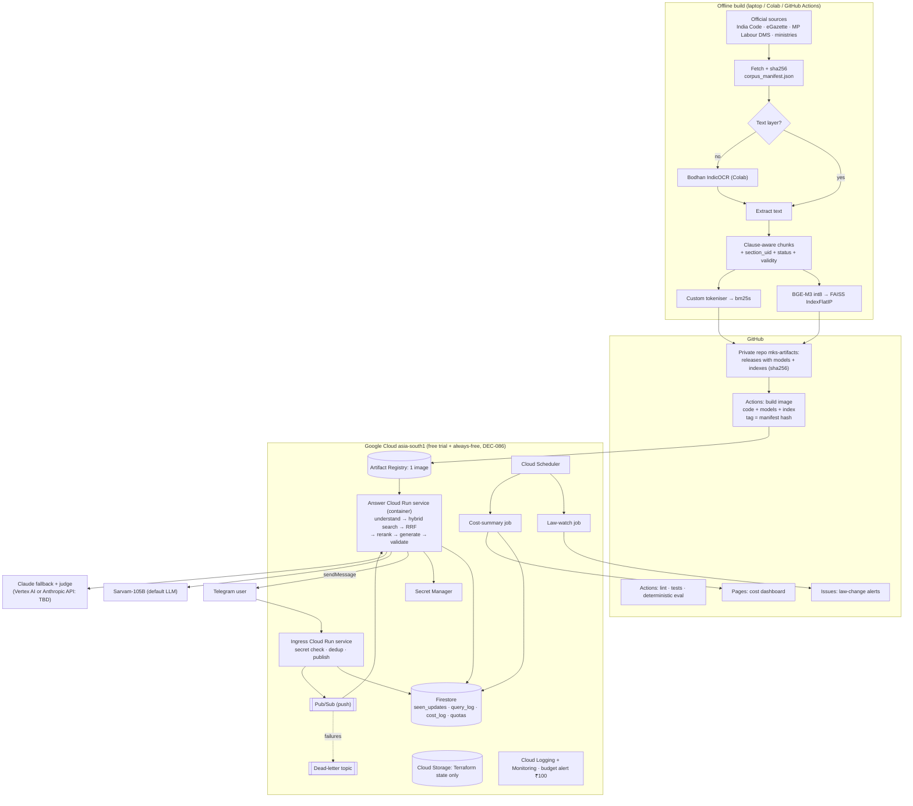

# Architecture — Madhya Kanoon Saathi

Rebuilt from `docs/plan.md` §5/§7 and updated by `docs/DECISIONS.md` (always-free serverless, no vector DB).
Three parts: an **offline** ingestion/index build, an **online** answer path on Google Cloud (DEC-086), and **CI/ops** around them.

## How it works

**Offline build.** Every legal source is downloaded with its checksum and status into `corpus_manifest.json`.
Born-digital PDFs give text directly; scanned ones go through Bodhan IndicOCR. Text is split along the law's own
structure (sub-section chunks with provisos attached), tagged with `section_uid`, state, status and validity dates,
then indexed twice: BGE-M3 vectors in an exact FAISS index, and a BM25 index using our Hindi-aware tokeniser.

**Packaging.** Models and index files are published as release assets of the private repo `mks-artifacts` with their sha256
(DEC-084/085), downloaded by Actions with a read-only token. GitHub Actions
downloads and checks them, bakes code, int8 models and both index files into one container image, tagged with the
corpus manifest hash, and pushes it to Artifact Registry, which keeps one image. One image = one snapshot of code + law (DEC-024).
Raw PDFs have no cloud copy: the laptop copy, official URLs and manifest hashes are the provenance; a Cloud Storage bucket holds only
the Terraform state.

**Answer path.** Telegram calls the ingress Cloud Run service. It verifies the secret header, drops duplicate
`update_id`s via a create-if-absent Firestore write, publishes the message to Pub/Sub and returns 200 immediately.
Pub/Sub pushes it to the answer service, which runs the pipeline, calls Sarvam-105B (Claude fallback TBD), validates
every citation against the retrieved chunks, and replies with `sendMessage`. Failed deliveries go to a dead-letter
topic. Every step writes a `cost_log` row (DEC-010, DEC-086).

**Operations.** Cloud Scheduler triggers the weekly law-watch (checksum diff → GitHub issue → human approval → rebuild,
DEC-013) and the nightly cost summary (→ static dashboard on GitHub Pages, DEC-012). Secrets live in Secret Manager. No VPC;
security is least-privilege service accounts, encryption at rest, the webhook secret check, and PII redaction (DEC-029).

**Not in v1:** WhatsApp, voice, keep-warm ping, Marathi.
