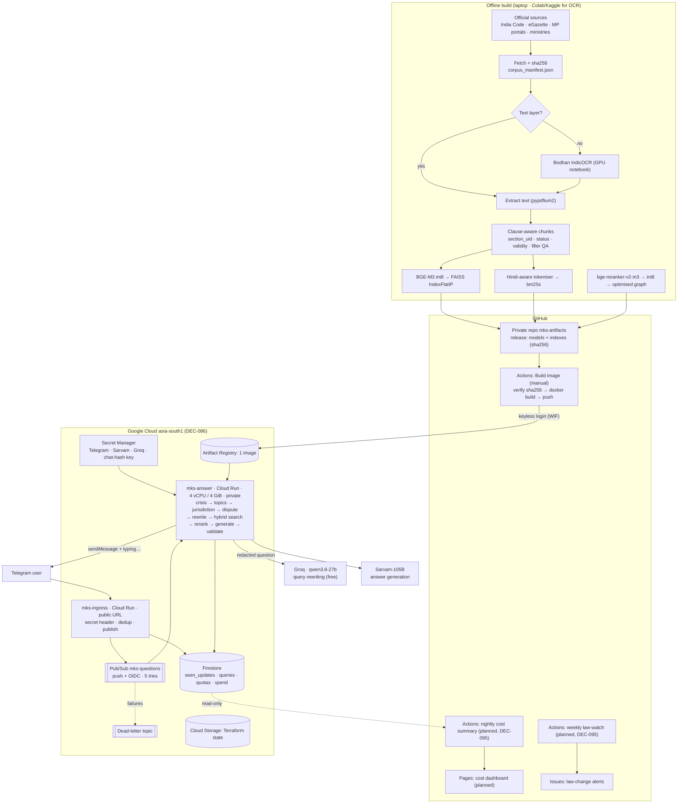

# Architecture — Madhya Kanoon Saathi

Updated 2026-11-24 to the second deployment (DEC-086 … DEC-095). Three parts: an **offline** ingestion and
index build, an **online** answer path on Google Cloud (Mumbai, `asia-south1`), and **GitHub** for builds and
operations. Measured results: [EVAL_REPORT.md](EVAL_REPORT.md); change history: [OPTIMIZATION.md](OPTIMIZATION.md);
reranker internals: [RERANKER.md](RERANKER.md); step-by-step cloud setup: [CONCEPTS.md §10](CONCEPTS.md).

## How it works

**Offline build.** Every legal source is downloaded with its checksum and legal status into
`corpus_manifest.json`; only documents whose status and commencement are verified are indexed (DEC-040).
Born-digital PDFs give text directly; scanned ones go through Bodhan IndicOCR. Text is split along the law's own
structure (sub-section chunks with provisos attached), tagged with `section_uid`, state, status and validity dates,
cleaned of filler (table rules, form blanks; build fails on mostly-filler chunks), then indexed twice: BGE-M3 int8
vectors in an exact FAISS index, and BM25 with a Hindi-aware tokeniser. The reranker is exported to ONNX once,
quantised to int8, and saved with ONNX Runtime's graph optimisations (`int8-opt`).

**Packaging.** Models and indexes are release assets of the private repo `mks-artifacts`, checksums in
`data/artifacts.json` (DEC-085). The manual **Build image** workflow downloads them with a read-only token,
verifies the checksums, builds one container (code + `serve` dependencies + models + indexes + approved wording)
with no provenance index (one push = one registry version), and pushes it to Artifact Registry through keyless
Workload Identity Federation. Image tag = corpus-manifest hash + commit: one image is one snapshot of law and code.

**Answer path.** Telegram posts each message to `mks-ingress`, which checks the secret header, drops duplicates
with a create-if-absent Firestore write, publishes to Pub/Sub and replies 200 at once. Pub/Sub pushes to the
private `mks-answer` service (signed token, 5 attempts, then a dead-letter topic). The answer service:
1. shows "typing…", checks the chat's daily quota (20) — chat ids are stored only as keyed hashes;
2. runs the crisis router (rules + embeddings), the topic-list check, the other-state guard and the dispute
   detector — replies that need no law text stop here, without search;
3. rewrites the question into formal English and Hindi search queries on Groq (question redacted first; any
   failure = original question);
4. searches BM25 + dense for the question and both rewrites, fuses with RRF, drops filler and duplicate
   language versions, reranks the top 20 with the int8 cross-encoder, puts in-force law first, keeps 6;
5. asks Sarvam-105B for JSON claims with exact quotes (within the ₹20/day spend cap), validates every quote
   against the retrieved text, and abstains if nothing survives;
6. sends the reply with citations, status caveats, "law as of" and the not-legal-advice footer, and writes one
   redacted record (costs and timings) to Firestore. Records expire after 90 days.

**Operations.** Secrets in Secret Manager (each service reads only its own); least-privilege service accounts; no
VPC; budget alert ₹100. Planned (DEC-095): a nightly GitHub Actions job aggregates the previous day's records with
a read-only account into a public GitHub Pages cost dashboard (aggregates only), and a weekly GitHub Actions
law-watch re-fetches sources and opens an issue on any change; rebuilds still need Malik's approval (DEC-013).

**Infrastructure as code.** `infra/terraform/bootstrap` (APIs, identities, IAM, Firestore, secret names, image
store; applied by Malik) and `infra/terraform/app` (queue, services, resource-level grants). CPU and model threads
come from one variable (`answer_cpu = 4`, DEC-094).

**Not in v1:** WhatsApp (planned W4), voice, keep-warm ping, Claude fallback/judge (DEC-086 item 9), Marathi.
