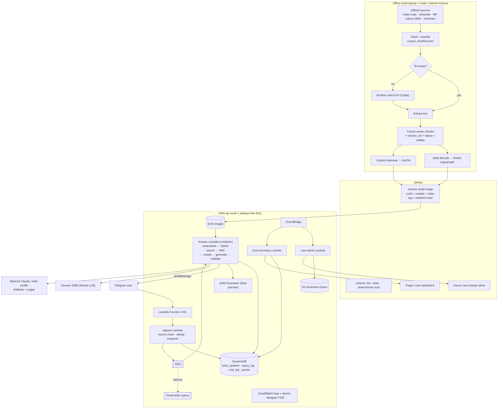

# Architecture — Madhya Kanoon Saathi

Rebuilt from `docs/plan.md` §5/§7 and updated by `docs/DECISIONS.md` (always-free serverless, no vector DB).
Three parts: an **offline** ingestion/index build, an **online** answer path on AWS, and **CI/ops** around them.

## How it works

**Offline build.** Every legal source is downloaded with its checksum and status into `corpus_manifest.json`.
Born-digital PDFs give text directly; scanned ones go through Bodhan IndicOCR. Text is split along the law's own
structure (sub-section chunks with provisos attached), tagged with `section_uid`, state, status and validity dates,
then indexed twice: BGE-M3 vectors in an exact FAISS index, and a BM25 index using our Hindi-aware tokeniser.

**Packaging.** GitHub Actions bakes code, int8 models and both index files into one container image, tagged with the
corpus manifest hash, and pushes it to ECR. One image = one snapshot of code + law (DEC-024).

**Answer path.** Telegram calls the ingress Lambda's Function URL. It verifies the secret header, drops duplicate
`update_id`s via a conditional DynamoDB write, puts the message on SQS and returns 200 immediately. The answer Lambda
runs the pipeline, calls Sarvam-105B (or Claude on Bedrock as fallback), validates every citation against the
retrieved chunks, and replies with `sendMessage`. Every step writes a `cost_log` row (DEC-010).

**Operations.** EventBridge triggers the weekly law-watch (checksum diff → GitHub issue → human approval → rebuild,
DEC-013) and the nightly cost summary (→ static dashboard on GitHub Pages, DEC-012). Secrets live in SSM. No VPC;
security is least-privilege IAM, encryption at rest, the webhook secret check, and PII redaction (DEC-029).

**Not in v1:** WhatsApp, voice, keep-warm ping, Marathi.
