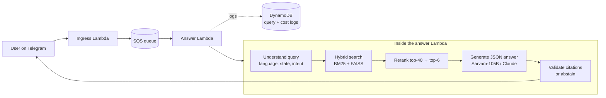
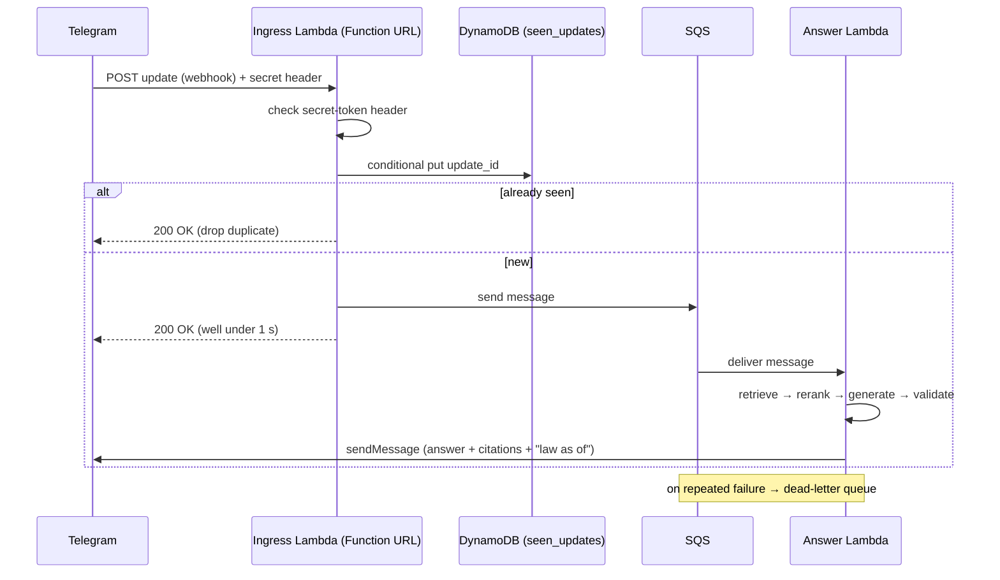
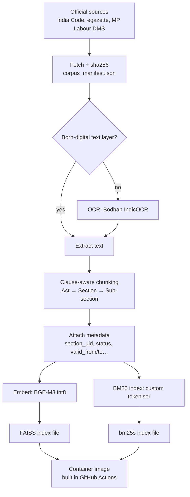
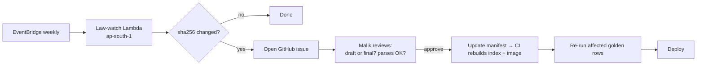
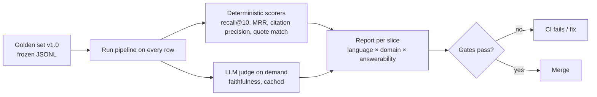

# Concepts — Madhya Kanoon Saathi

The important ideas, flows and techniques behind the project, in plain English. Each concept has three parts:
**What it is → Why it matters here → Interview angle.** Decisions are referenced as `DEC-NNN` (see `DECISIONS.md`).
Add a new concept whenever we introduce one. Keep entries short; link to TOOLS.md for the tool itself.

**Contents**
1. [The big picture](#1-the-big-picture)
2. [Flows](#2-flows): request, ingestion, retrieval + generation, law-watch, evaluation
3. [Legal-domain concepts](#3-legal-domain-concepts)
4. [Data and chunking](#4-data-and-chunking)
5. [Retrieval](#5-retrieval)
6. [Generation and safety](#6-generation-and-safety)
7. [Evaluation](#7-evaluation)
8. [Serverless and cost](#8-serverless-and-cost)
9. [Engineering practices](#9-engineering-practices)

---

## 1. The big picture

**RAG (Retrieval-Augmented Generation).** Instead of asking an LLM to answer from memory, we first *retrieve* the
relevant law text from our own corpus, then ask the LLM to answer *only* from that text, with citations.
- Why here: LLMs invent section numbers and ignore state differences. Retrieval grounds every answer in the
  actual statute; the validator (§6) proves it.
- Interview angle: "RAG moves the knowledge out of the model weights into a corpus I can version, audit and update weekly."

---

## 2. Flows

### 2.1 Request flow (DEC-010)

**Webhook.** Telegram calls *our* URL whenever a user sends a message (push), instead of us polling Telegram.
- Why here: free and instant. But Telegram resends if we don't reply 200 quickly, so the reply must be fast.

**Idempotency / de-duplication.** Processing the same message twice must have the same effect as processing it once.
We store each `update_id` with a *conditional write* that fails if the key already exists.
- Interview angle: "At-least-once delivery + idempotent consumer = effectively-once processing."

**Queue decoupling (SQS).** The fast part (accepting the message) and the slow part (answering) are separated by a queue.
- Why here: absorbs cold starts, gives automatic retries, and lets us cap concurrency to respect Sarvam's 60 req/min.

**Dead-letter queue (DLQ).** Messages that keep failing are moved aside instead of retrying forever.
- Why here: a broken message doesn't block others, and we can inspect what went wrong.

### 2.2 Ingestion flow (offline, on laptop / Colab / CI)

### 2.3 Retrieval + generation flow (per question)

0. **Crisis router:** check for danger signals first; if found, helpline numbers lead the reply (DEC-033).
1. **Query understanding:** detect language (hi / hinglish / en), state, domain, intent; pre-check for "needs a lawyer".
2. **Query rewrite:** cheap LLM call produces an English + Hindi version of the question (cross-lingual, §5).
3. **Hybrid retrieval:** BM25 and FAISS each return candidates, with filters `state ∈ {MP, central}`, status, valid today.
4. **Fusion:** Reciprocal Rank Fusion merges the lists → top-40.
5. **Rerank:** cross-encoder scores each (question, chunk) pair → top-6.
6. **Generate:** LLM returns strict JSON claims, each tied to a `chunk_id` and an exact quote.
7. **Validate:** code checks every citation; retry once; strip unsupported claims; abstain if nothing survives.
8. **Reply** in the user's language with citations, status caveats, `Law as of <date>`, and a "not legal advice" footer.

### 2.4 Law-watch flow (DEC-013)

### 2.5 Evaluation flow

---

## 3. Legal-domain concepts

These describe how the product *treats* law. They are not legal content. Any actual legal fact
(sections, dates, amounts) comes only from corpus files with a citation.

**Legal information vs legal advice.** We explain what the law says, how a process works and where to go.
We never tell a specific person what to do in their case ("you will win", "sue X"). Source: plan §3.
- Why here: practising law is reserved to enrolled advocates; information is not. This defines our refusal rules.

**Jurisdiction / state vs central law.** Some subjects are state subjects (e.g., tenancy, per plan §Key Findings),
some are concurrent (e.g., labour). The same question can have different answers in different states.
- Why here: our edge is being *MP-correct*. Every chunk carries `state`; every query is filtered by state.

**Status flags.** Each instrument is tagged `in_force | draft | model_law | repealed | sub_judice_flag |
passed_awaiting_assent | proposal`, with an optional `expires_on` (DEC-033). Examples of traps are in CORPUS.md.
- Why here: MP labour rules are drafts, the Model Tenancy Act is only a model, and the RTI amendment is under challenge
  (all per plan.md). The bot must *say so* in the answer rather than present them as settled law.

**"Law as of" date (time-versioning).** Every chunk has `valid_from` / `valid_to`; every answer prints the date its
corpus snapshot reflects. Example from plan.md: MP minimum wages carry a validity window.
- Interview angle: "Legal RAG is a time-series problem: the right answer depends on the date."

**Escalation.** When we abstain, we point to statutory free legal aid (DLSA/NALSA, Tele-Law/Nyaya Setu), never to
private lawyers (BCI Rule 36, plan §3). Contact details come from `contacts.yaml` with sources (DEC-018).

**DPDP minimisation.** Collect as little personal data as possible: hashed user IDs, PII redaction before logs,
90-day auto-delete (DynamoDB TTL), age gate, delete-my-data command. Dates of DPDP phases are in plan §Key Findings.

---

## 4. Data and chunking

**Corpus manifest.** One JSON file in git listing every source document: URL, fetch date, sha256, status, storage path.
- Why: raw PDFs are not in git; the manifest proves exactly which version of each law we used.

**Partial indexing (`index_scope`, DEC-051).** A document can list the provisions that may be indexed (e.g. only
TPA ss.105–111). Only those provisions and their sub-units are chunked.
- Why: indexing a whole Act when we only checked one part lets the bot answer from unchecked text. The scope is
  written in the manifest and checked by code, not left to the chunker's memory.

**Model laws (DEC-052).** A model law (e.g. the Model Tenancy Act 2021) is a template the Centre gives states to adapt.
It is not law in MP unless MP enacts it. Its own type is non-binding and never "current", and it can be indexed with a
status check alone.
- Why: a model law is often asked about, so the bot can explain it, but it must always say "not in force in MP".

**Provenance levels for a source.** The strongest source is a file on the issuing body's own site. Next are an
Internet Archive copy of that file (DEC-049) and a file on another official body's site (e.g. CGTMSE hosting MoHUA's
SVANidhi annexures). A file supplied by hand is accepted only once its hash matches one of these. When the issuing
letter or signature has not been seen, the document is indexed with a qualification note.
- Interview angle: "hash-matching user-supplied files against live official URLs turned 'someone sent me a PDF'
  into a verifiable source."

**Checksum (sha256).** A fingerprint of a file's bytes. Any change, even one character, gives a different value.
- Why here: law-watch detects changes by comparing checksums; it also catches corrupted downloads.

**Born-digital vs scanned.** A born-digital PDF already contains text; a scanned PDF is just images and needs OCR.
- Why: born-digital text is exact; OCR introduces errors. Always prefer born-digital.

**OCR and CER.** OCR turns page images into text. **Character Error Rate** = (insertions + deletions + substitutions)
÷ characters in the correct text. Lower is better.
- Why here: an OCR mistake becomes a wrong quote. The bake-off (DEC-014) measures CER on *our* pages.

**Enacted vs commenced, and amending laws (DEC-044).** A law can be passed, assented and published but not yet in force
(e.g. commencement "on a date the government notifies"). It gets status `enacted_not_commenced`, which is never "current".
Each amending law is its own instrument with `amends: [...]`, so a citation points to the exact text that changed the
Act or its Rules.
- Interview angle: "time-aware legal data". The model must never call a law "in force" just because it was published.

**Version chains for drafts (DEC-047/048).** Successive drafts and the final text are separate documents linked by
`supersedes` / `superseded_by`. A `draft` can be indexed with a confirmed status check alone, but it is never "current",
so the bot always labels it as a draft.
- Interview angle: provenance. You can show exactly which version of a rule an answer relied on, and when it changed.

**Recovering official files from a dead site (DEC-049).** When a government site is down, the Internet Archive often holds the
department's own files. The CDX index lists archived URLs, and an `id_` URL returns the original bytes. We record the original
URL, the snapshot time and the sha256, so the copy is as traceable as a live download.
- Interview angle: provenance engineering. Availability problems are solved without lowering the "official source only" bar.

**Corrupted text layers (seen in W0.4).** A PDF can "have text" that is wrong. Seen so far:
- a Latin-only OCR layer in a Hindi scan
- ि extracted as ध by an old font converter
- Latin-extended glyphs from Excel → Print-to-PDF

The downloader rejects the first (Devanagari share < 50% for Hindi); the others need a text-quality check in W1.1
(e.g. hit-rate on very common Hindi words) or OCR.
- Why: exact-quote citation is only as good as the text; a corrupt layer means wrong or unmatched quotes.

**Site-specific download resolvers.** Some official portals don't serve files at a stable URL. For example, the MP Labour DMS
uses a viewer page followed by a session-bound PDF link. The manifest keeps the stable, citable URL; a named resolver knows how to turn it
into bytes.
- Why: citations stay stable while download quirks stay in one tested function.

**Unicode normalisation (NFC) and nukta folding.** The same visible Hindi text can be stored as different byte sequences.
NFC converts to one canonical form; nukta folding treats क़ and क + ़ alike.
- Why here: exact-quote validation and BM25 both compare text; without normalisation identical-looking text won't match.

**Clause-aware chunking.** Split law along its own structure (Act → Chapter → Section → Sub-section → Clause → Proviso
/ Explanation), not every N tokens. Chunk unit = sub-section, with its provisos and explanations attached; 150–450 tokens.
- Why: a proviso cut away from its sub-section changes the meaning; structural chunks make citations precise.

**section_uid and chunk_id (DEC-040).** A canonical ID per legal unit, e.g., `IN.RTI2005:s8:ss1:cl_j` (`IN` central,
`MP` state). Hindi and English chunks of the same unit share it; each stored text version is a `chunk_id`
(`<uid>@<lang>@<valid_from>`). Spec: `docs/specs/section_uid.md`.
- Why: links languages, makes eval matching exact ("did we retrieve the expected section?"), and powers caching.
  The jurisdiction prefix makes state-vs-central visible everywhere.
- Interview angle: the hierarchy lives *inside* the ID, so parents are computed, not stored; nothing can drift.
  Coverage = "equal or ancestor" (a sub-section chunk answers a question about one of its clauses).

**Derived vs stored metadata.** Store facts once (type, dates, status); compute the rest (authority rank, binding,
"is current today", parent uid). A stored copy of a derived value goes stale silently; a computed one can't.

**Verification provenance + index gate (DEC-040).** Each manifest document carries records of *what* was checked
(status, commencement, text match, interpretation), *by whom* (Claude / Malik / advocate), *how*, and the evidence.
The validator refuses `mode=index` without confirmed status + commencement checks.
- Why: "unverified law never reaches users" becomes a rule enforced by code, not a habit.

**Authority level and applicability.** Acts > rules > notifications > scheme guidelines > official guides, but rank
is *not* a search weight (the notification often holds the number the user wants). It decides conflicts (law beats
guide) and what may support a rights claim. `applies_to` records national / state / district / area scope; only
state scope is enforced in v1.

**Parent-child retrieval.** Search over small chunks (precise), but give the LLM the parent section when more context is needed.

**Chunk metadata.** `chunk_id, section_uid, parent_uid, doc_id, instrument_id, language, heading, page` plus fields
inherited from the manifest (status, validity, applies_to, type). Final chunk schema is decided in W1.1.

---

## 5. Retrieval

**Sparse (keyword) retrieval: BM25.** Scores documents by how often the query's words appear, adjusted for rarity and
document length.
- Why here: section numbers ("धारा 8(1)(j)") and legal terms need exact matches that meaning-based search can miss.

**Tokenisation.** Cutting text into tokens before indexing. Our custom tokeniser (DEC-026) normalises Unicode,
converts Devanagari digits, keeps section references as one token, and maps धारा/section/dhara to one token.

**Dense (semantic) retrieval: embeddings.** A model (BGE-M3) turns text into a vector; texts with similar meaning have
vectors pointing in similar directions. Similarity = cosine (inner product of normalised vectors).
- Why here: finds "landlord kept my deposit" even if the statute says "security amount".

**Hybrid retrieval + RRF.** Run BM25 and dense search, then merge with **Reciprocal Rank Fusion**: each document scores
Σ 1/(k + rank) across lists (k is a constant, commonly 60).
- Why RRF: it uses only ranks, so we don't need to make BM25 scores and cosine scores comparable.

**Exact vs approximate nearest-neighbour search.** Exact (FAISS `IndexFlatIP`) compares the query with every vector;
approximate (HNSW, IVF) skips most of them for speed and can miss results (DEC-025).
- Interview angle: "At 30K vectors exact search takes milliseconds; approximation would buy nothing and cost recall,
  and it makes metadata filtering less reliable."

**Metadata filtering.** Restrict results by `state`, `status`, and validity date before ranking.

**Cross-lingual retrieval.** The question may be Hinglish; the best chunk may be English. We store official Hindi and
English texts and search with the original query plus an LLM rewrite. Statute text is **never machine-translated**
for citation; translation is only for explanations.

**Cross-encoder reranking.** A bi-encoder (embedding model) encodes question and chunk separately, which is fast but rough.
A cross-encoder (bge-reranker-v2-m3) reads question + chunk *together* and scores relevance much more accurately,
but it's slow, so we only rerank the top-40.
- Interview angle: "Retrieve wide and cheap, then rerank narrow and expensive."

---

## 6. Generation and safety

**Structured output (JSON claims).** The LLM must return
`{answer_blocks:[{text, citations:[{chunk_id, quote}]}], abstain, abstain_reason, escalation}`.
- Why: free text can't be checked by code; JSON can.

**Citation validator.** Rejects any `chunk_id` not in the retrieved context and any `quote` that isn't an exact substring
of that chunk (after NFC). Retry once → strip unsupported claims → abstain if none survive.
- Interview angle: "I don't *trust* the model to cite correctly; I *verify* it deterministically."

**Abstention.** Refuse (with a referral) when the rerank score is below a calibrated threshold, the state isn't covered,
or the user wants individual advice. For draft / model-law / sub-judice instruments, answer **with a caveat** instead.
- Why: a confident wrong legal answer is worse than "I can't answer this; here's free legal aid".

**Crisis router (DEC-033).** A check that runs on every message *before* retrieval. If it finds signs of danger
(violence, a child at risk, fraud in progress, self-harm), the reply starts with the relevant emergency or helpline
numbers, sourced from `contacts.yaml`. Legal information comes after that, or not at all.
- Why: In an emergency, a citation-perfect legal answer delivered second is worse than a phone number delivered first.
  Missing a crisis is the worst failure, so the gate is recall = 100%; a few false alarms are acceptable.
- Interview angle: "I route before I retrieve. Safety classification is a separate, high-recall stage, not
  something I hope the generator handles."

**Expiry-aware answers (DEC-033).** Seasonal schemes and time-bound notifications carry `expires_on`. When a retrieved
instrument has expired, the bot abstains instead of quoting stale dates or amounts.

**Sensitive-data minimisation (DEC-033).** The bot never asks for caste, disability, health or religion. If a user
volunteers it, it's used only within that session and redacted from all storage. Caste comes up naturally in
certificate questions, so this rule needs tests, not just good intentions.

**Jurisdiction guard and dispute detector (DEC-033; moved to the November MVP with the land slice, DEC-038).** The jurisdiction guard is a hard filter so that land and
family answers never come from another state's law (e.g., the Chhattisgarh or Maharashtra Land Revenue Codes). The
dispute detector answers the procedure ("how do I apply for demarcation") but sends merits questions ("is this land
mine?") to DLSA.

**Model fallback / routing.** Sarvam-105B is the default; on validator failure twice or provider error (e.g., 402),
fall back to Claude on Bedrock (DEC-006).

**Native-language generation.** Generate directly in the user's language instead of English → translate.
- Why: cheaper (translation APIs cost more than generation, per plan §8) and keeps natural register.

**Prompt and rubric versioning.** Prompts are files with versions; changing one is a major decision (it changes what
the bot tells users about the law).

---

## 7. Evaluation

**Golden set.** 120 real (redacted) questions with expected clauses, key facts, must/must-not-include phrases, and
answerability. Frozen as `v1.0`; never edited silently; changes go into `v1.1`.
- Why: every claim about quality ("recall 0.87") is measured on this fixed set.

**Slices.** Report every metric per language (hi / hinglish / en) × domain × answerability, not just overall.
- Why: a good average can hide a bad Hindi score.

**Retrieval metrics.**
- **Recall@10**: share of expected sections found in the top 10.
- **MRR@10**: average of 1/rank of the first correct result (rewards putting it near the top).
- **nDCG@10**: like MRR but credits all relevant results, discounted by position.

**Citation metrics (deterministic).** Citation precision (cited ⊆ retrieved ∩ expected-or-supporting), citation recall,
quote exact-match rate (gate = 1.00).

**Faithfulness.** Share of answer claims supported by the cited context; scored by an LLM judge.

**Abstain F1.** Precision/recall of refusing exactly the questions that should be refused.

**LLM-as-judge + calibration (Cohen's κ).** A strong model grades answers. We hand-grade 40 answers and measure agreement
with Cohen's κ (agreement corrected for chance; target ≥ 0.6). Recalibrate if the judge model changes.

**Judge cache.** Verdicts are stored under a hash of (question, cited chunk IDs, answer, judge model, rubric version),
so unchanged answers are never re-judged (DEC-023).

**Inter-annotator agreement.** A second reviewer double-labels ≥30 rows; we report agreement on answerability and clauses.

**CI regression gates.** Free deterministic metrics run on every PR; the PR fails if a gate drops. Judged runs are
on demand in v1 (DEC-023).

**int8 acceptance margin.** int8 models are accepted only if recall@10 is within 0.02 of fp32, overall and per
language (DEC-021).

---

## 8. Serverless and cost

**Serverless (Lambda).** Code runs only when an event arrives; no server runs while idle. Billed per request and per
GB-second (memory × duration).
- Why here: a demo bot is idle most of the time, so serverless + always-free tier ≈ ₹0.

**GB-seconds.** Memory size × run time. A 3 GB function running 4 s uses 12 GB-s. Doubling memory also roughly doubles CPU,
so a function can finish in half the time at the same GB-s.

**Cold start.** The first request to a new function instance must start the runtime and load models (10–20 s here,
estimated). Later "warm" requests are fast. We gate warm p95 and report cold separately (DEC-020).

**Keep-warm ping.** A scheduled call every few minutes keeps one instance loaded (planned for v2).

**p50 / p95 latency.** The time within which 50% / 95% of requests finish. p95 shows the slow tail users actually feel.

**Quantisation (int8).** Store model weights as 8-bit integers instead of 32-bit floats: ~4× smaller, faster on CPU,
with a small possible accuracy loss that we measure (DEC-021).

**ONNX.** A portable model format; ONNX Runtime runs it efficiently on CPU without PyTorch.

**Train/serve skew (embedding parity).** If the corpus is embedded with one model build and queries with another, the
vectors don't match and quality drops silently. Our parity test catches this (DEC-022).

**Unit economics (₹/query).** Cost per question, broken down by step and provider, logged in `cost_log`.
- Interview angle (plan §8): "On the Sarvam path, model inference isn't the main cost; messaging and voice are."

**Budget guardrails.** AWS budget alert (₹100), per-user daily quotas, fallback routing, cached judge results.

**Data residency.** Keep user data in India: ap-south-1 region, Bedrock India geo profile (routes only within India per
plan.md), and a self-hosted reranker, because Bedrock Rerank isn't offered in ap-south-1.

---

## 9. Engineering practices

**Infrastructure as Code (Terraform).** Cloud resources are defined in code, reviewed, and applied with `plan` → `apply`.
- Why: reproducible, reviewable, and every change is visible before it costs money.

**OIDC deploys.** GitHub Actions gets short-lived AWS credentials by proving its identity; no long-lived keys stored.

**Immutable image = law snapshot.** The container image contains code + models + index; its tag carries the corpus
manifest hash, so a rollback restores both code and law text (DEC-024).

**Least privilege.** Each Lambda gets only the permissions it needs (e.g., ingress can write to SQS, not read secrets it
doesn't use).

**Secrets hygiene.** Secrets live in `.env` (local, git-ignored) and SSM (prod); never logged; a secret scanner runs before commits.

**Decision records (ADRs).** Every major choice is written in DECISIONS.md with options and reasons. It's useful for interviews too.

**Human-in-the-loop for legal changes.** Automation detects; a human approves (DEC-013).
