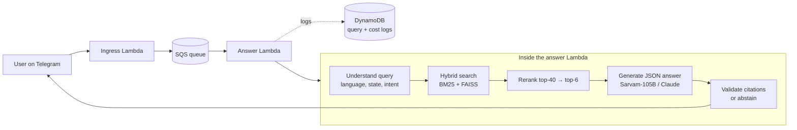
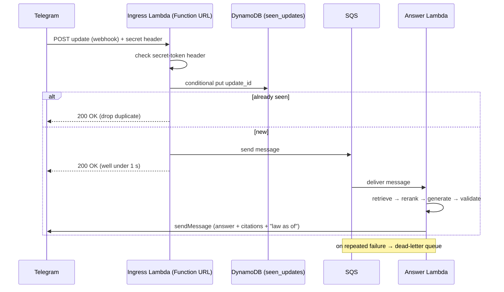
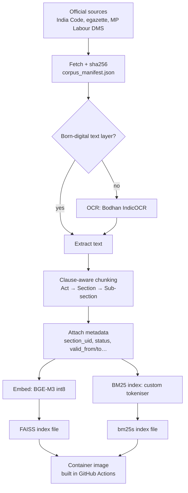
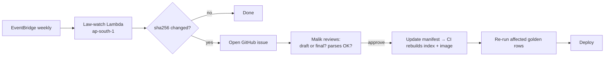
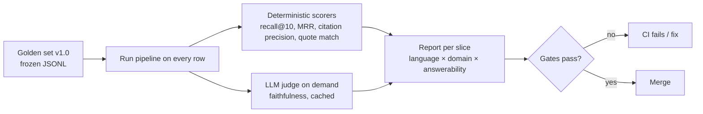

# Concepts — Madhya Kanoon Saathi

The important ideas, flows and techniques behind the project, in plain English. Each concept has three parts:
**What it is → Why it matters here → Interview angle.** Decisions are referenced as `DEC-NNN` (see `DECISIONS.md`).
Add a new concept whenever we introduce one. Keep entries short; link to TOOLS.md for the tool itself.

**Contents**
1. [The big picture](#1-the-big-picture)
2. [Flows](#2-flows): request, ingestion, retrieval + generation, law-watch, evaluation
3. [Legal-domain concepts](#3-legal-domain-concepts)
4. [Data and chunking](#4-data-and-chunking)
5. [Retrieval](#5-retrieval)
6. [Generation and safety](#6-generation-and-safety)
7. [Evaluation](#7-evaluation)
8. [Serverless and cost](#8-serverless-and-cost)
9. [Engineering practices](#9-engineering-practices)

---

## 1. The big picture

**RAG (Retrieval-Augmented Generation).** Instead of asking an LLM to answer from memory, we first *retrieve* the
relevant law text from our own corpus, then ask the LLM to answer *only* from that text, with citations.
- Why here: LLMs invent section numbers and ignore state differences. Retrieval grounds every answer in the
  actual statute; the validator (§6) proves it.
- Interview angle: "RAG moves the knowledge out of the model weights into a corpus I can version, audit and update weekly."

---

## 2. Flows

### 2.1 Request flow (DEC-010)

**Webhook.** Telegram calls *our* URL whenever a user sends a message (push), instead of us polling Telegram.
- Why here: free and instant. But Telegram resends if we don't reply 200 quickly, so the reply must be fast.

**Idempotency / de-duplication.** Processing the same message twice must have the same effect as processing it once.
We store each `update_id` with a *conditional write* that fails if the key already exists.
- Interview angle: "At-least-once delivery + idempotent consumer = effectively-once processing."

**Queue decoupling (SQS).** The fast part (accepting the message) and the slow part (answering) are separated by a queue.
- Why here: absorbs cold starts, gives automatic retries, and lets us cap concurrency to respect Sarvam's 60 req/min.

**Dead-letter queue (DLQ).** Messages that keep failing are moved aside instead of retrying forever.
- Why here: a broken message doesn't block others, and we can inspect what went wrong.

### 2.2 Ingestion flow (offline, on laptop / Colab / CI)

### 2.3 Retrieval + generation flow (per question)

0. **Crisis router:** check for danger signals first; if found, helpline numbers lead the reply (DEC-033).
1. **Query understanding:** detect language (hi / hinglish / en), state, domain, intent; pre-check for "needs a lawyer".
2. **Query rewrite:** cheap LLM call produces an English + Hindi version of the question (cross-lingual, §5).
3. **Hybrid retrieval:** BM25 and FAISS each return candidates, with filters `state ∈ {MP, central}`, status, valid today.
4. **Fusion:** Reciprocal Rank Fusion merges the lists → top-40.
5. **Rerank:** cross-encoder scores each (question, chunk) pair → top-6.
6. **Generate:** LLM returns strict JSON claims, each tied to a `chunk_id` and an exact quote.
7. **Validate:** code checks every citation; retry once; strip unsupported claims; abstain if nothing survives.
8. **Reply** in the user's language with citations, status caveats, `Law as of <date>`, and a "not legal advice" footer.

### 2.4 Law-watch flow (DEC-013)

### 2.5 Evaluation flow

---

## 3. Legal-domain concepts

These describe how the product *treats* law. They are not legal content. Any actual legal fact
(sections, dates, amounts) comes only from corpus files with a citation.

**Legal information vs legal advice.** We explain what the law says, how a process works and where to go.
We never tell a specific person what to do in their case ("you will win", "sue X"). Source: plan §3.
- Why here: practising law is reserved to enrolled advocates; information is not. This defines our refusal rules.

**Jurisdiction / state vs central law.** Some subjects are state subjects (e.g., tenancy, per plan §Key Findings),
some are concurrent (e.g., labour). The same question can have different answers in different states.
- Why here: our edge is being *MP-correct*. Every chunk carries `state`; every query is filtered by state.

**Status flags.** Each instrument is tagged `in_force | draft | model_law | repealed | sub_judice_flag |
passed_awaiting_assent | proposal`, with an optional `expires_on` (DEC-033). Examples of traps are in CORPUS.md.
- Why here: MP labour rules are drafts, the Model Tenancy Act is only a model, and the RTI amendment is under challenge
  (all per plan.md). The bot must *say so* in the answer rather than present them as settled law.

**"Law as of" date (time-versioning).** Every chunk has `valid_from` / `valid_to`; every answer prints the date its
corpus snapshot reflects. Example from plan.md: MP minimum wages carry a validity window.
- Interview angle: "Legal RAG is a time-series problem: the right answer depends on the date."

**Escalation.** When we abstain, we point to statutory free legal aid (DLSA/NALSA, Tele-Law/Nyaya Setu), never to
private lawyers (BCI Rule 36, plan §3). Contact details come from `contacts.yaml` with sources (DEC-018).

**DPDP minimisation.** Collect as little personal data as possible: hashed user IDs, PII redaction before logs,
90-day auto-delete (DynamoDB TTL), age gate, delete-my-data command. Dates of DPDP phases are in plan §Key Findings.

---

## 4. Data and chunking

**Corpus manifest.** One JSON file in git listing every source document: URL, fetch date, sha256, status, storage path.
- Why: raw PDFs are not in git; the manifest proves exactly which version of each law we used.

**Partial indexing (`index_scope`, DEC-051).** A document can list the provisions that may be indexed (e.g. only
TPA ss.105–111). Only those provisions and their sub-units are chunked.
- Why: indexing a whole Act when we only checked one part lets the bot answer from unchecked text. The scope is
  written in the manifest and checked by code, not left to the chunker's memory.

**Model laws (DEC-052).** A model law (e.g. the Model Tenancy Act 2021) is a template the Centre gives states to adapt.
It is not law in MP unless MP enacts it. Its own type is non-binding and never "current", and it can be indexed with a
status check alone.
- Why: a model law is often asked about, so the bot can explain it, but it must always say "not in force in MP".

**Provenance levels for a source.** The strongest source is a file on the issuing body's own site. Next are an
Internet Archive copy of that file (DEC-049) and a file on another official body's site (e.g. CGTMSE hosting MoHUA's
SVANidhi annexures). A file supplied by hand is accepted only once its hash matches one of these. When the issuing
letter or signature has not been seen, the document is indexed with a qualification note.
- Interview angle: "hash-matching user-supplied files against live official URLs turned 'someone sent me a PDF'
  into a verifiable source."

**Checksum (sha256).** A fingerprint of a file's bytes. Any change, even one character, gives a different value.
- Why here: law-watch detects changes by comparing checksums; it also catches corrupted downloads.

**Born-digital vs scanned.** A born-digital PDF already contains text; a scanned PDF is just images and needs OCR.
- Why: born-digital text is exact; OCR introduces errors. Always prefer born-digital.

**OCR and CER.** OCR turns page images into text. **Character Error Rate** = (insertions + deletions + substitutions)
÷ characters in the correct text. Lower is better.
- Why here: an OCR mistake becomes a wrong quote. The bake-off (DEC-014) measures CER on *our* pages.

**Enacted vs commenced, and amending laws (DEC-044).** A law can be passed, assented and published but not yet in force
(e.g. commencement "on a date the government notifies"). It gets status `enacted_not_commenced`, which is never "current".
Each amending law is its own instrument with `amends: [...]`, so a citation points to the exact text that changed the
Act or its Rules.
- Interview angle: "time-aware legal data". The model must never call a law "in force" just because it was published.

**Version chains for drafts (DEC-047/048).** Successive drafts and the final text are separate documents linked by
`supersedes` / `superseded_by`. A `draft` can be indexed with a confirmed status check alone, but it is never "current",
so the bot always labels it as a draft.
- Interview angle: provenance. You can show exactly which version of a rule an answer relied on, and when it changed.

**Recovering official files from a dead site (DEC-049).** When a government site is down, the Internet Archive often holds the
department's own files. The CDX index lists archived URLs, and an `id_` URL returns the original bytes. We record the original
URL, the snapshot time and the sha256, so the copy is as traceable as a live download.
- Interview angle: provenance engineering. Availability problems are solved without lowering the "official source only" bar.

**Corrupted text layers (seen in W0.4).** A PDF can "have text" that is wrong. Seen so far:
- a Latin-only OCR layer in a Hindi scan
- ि extracted as ध by an old font converter
- Latin-extended glyphs from Excel → Print-to-PDF

The downloader rejects the first (Devanagari share < 50% for Hindi); the others need a text-quality check in W1.1
(e.g. hit-rate on very common Hindi words) or OCR.
- Why: exact-quote citation is only as good as the text; a corrupt layer means wrong or unmatched quotes.

**Site-specific download resolvers.** Some official portals don't serve files at a stable URL. For example, the MP Labour DMS
uses a viewer page followed by a session-bound PDF link. The manifest keeps the stable, citable URL; a named resolver knows how to turn it
into bytes.
- Why: citations stay stable while download quirks stay in one tested function.

**Unicode normalisation (NFC) and nukta folding.** The same visible Hindi text can be stored as different byte sequences.
NFC converts to one canonical form; nukta folding treats क़ and क + ़ alike.
- Why here: exact-quote validation and BM25 both compare text; without normalisation identical-looking text won't match.

**Clause-aware chunking.** Split law along its own structure (Act → Chapter → Section → Sub-section → Clause → Proviso
/ Explanation), not every N tokens. Chunk unit = sub-section, with its provisos and explanations attached; 150–450 tokens.
- Why: a proviso cut away from its sub-section changes the meaning; structural chunks make citations precise.

**section_uid and chunk_id (DEC-040).** A canonical ID per legal unit, e.g., `IN.RTI2005:s8:ss1:cl_j` (`IN` central,
`MP` state). Hindi and English chunks of the same unit share it; each stored text version is a `chunk_id`
(`<uid>@<lang>@<valid_from>`). Spec: `docs/specs/section_uid.md`.
- Why: links languages, makes eval matching exact ("did we retrieve the expected section?"), and powers caching.
  The jurisdiction prefix makes state-vs-central visible everywhere.
- Interview angle: the hierarchy lives *inside* the ID, so parents are computed, not stored; nothing can drift.
  Coverage = "equal or ancestor" (a sub-section chunk answers a question about one of its clauses).

**Derived vs stored metadata.** Store facts once (type, dates, status); compute the rest (authority rank, binding,
"is current today", parent uid). A stored copy of a derived value goes stale silently; a computed one can't.

**Verification provenance + index gate (DEC-040).** Each manifest document carries records of *what* was checked
(status, commencement, text match, interpretation), *by whom* (Claude / Malik / advocate), *how*, and the evidence.
The validator refuses `mode=index` without confirmed status + commencement checks.
- Why: "unverified law never reaches users" becomes a rule enforced by code, not a habit.

**Authority level and applicability.** Acts > rules > notifications > scheme guidelines > official guides, but rank
is *not* a search weight (the notification often holds the number the user wants). It decides conflicts (law beats
guide) and what may support a rights claim. `applies_to` records national / state / district / area scope; only
state scope is enforced in v1.

**Parent-child retrieval.** Search over small chunks (precise), but give the LLM the parent section when more context is needed.

**Chunk metadata.** `chunk_id, section_uid, parent_uid, doc_id, instrument_id, language, heading, page` plus fields
inherited from the manifest (status, validity, applies_to, type). Final chunk schema is decided in W1.1.

---

**Raw vs canonical chunk text (DEC-055).** Every chunk stores the extractor's text unchanged (`raw_text`) and a
cleaned form (`text`: footnote numbers removed, line wraps joined, Unicode normalised). A small `raw_map` records
what was removed, so code can recompute `text` from `raw_text` and prove they match.
- Why: quotes shown to users must be exact, and an auditor must be able to trace every quote back to the PDF.

**Extraction QA gates.** The chunk build stops on hard errors (invalid provision ID, chunk outside the corpus scope,
missing page number, raw/canonical mismatch, duplicate ID) and only warns on soft ones (chunk size, odd pages).
- Interview angle: "data quality is enforced like a test suite: a bad build never reaches the index."

**Layout cues beat text patterns.** In India Code PDFs, footnotes look like section starts ("1. Subs. by ...").
Font size separates them reliably: body 11 pt, footnotes 9 pt, superscript markers 7 pt.

**OCR text as raw text (W1.1b, DEC-071).** For scanned gazettes the "extractor" is Bodhan IndicOCR. Its output is
stored unchanged as `raw_text` (including its `▁` word marks, HTML table tags and dotted fill-in lines); the cleanup
runs only inside the canonical-text function, switched on by an `ocr` flag. So the raw ↔ canonical audit still holds,
and born-digital chunks are untouched.
- Why: you can always show exactly what the OCR engine produced, and fix cleanup rules without re-running OCR.

**Structural alignment of Hindi and English (W1.1b, section_uid rule 2).** A Hindi provision gets the same
`section_uid` as its English counterpart, so a question in either language finds the same law. Rule and sub-rule
numbers are matched by number (digits are the same in both texts); clauses, provisos and explanations by their
**position** among siblings, never by mapping (ख) to (b). If the two texts have a different number of sub-units, the
Hindi provision is kept whole under the parent uid and reported.
- Example: RTI Rules 2012 r.14 lists 4 modes of service in English but 3 in the official Hindi (no registered post).
  Position matching alone would have labelled Hindi "e-mail" as English "registered post"; the count check prevents it.
- Interview angle: "alignment fails safe: when unsure it becomes coarser, never wrong."

## 5. Retrieval

Full reranker design, timings and optimisation options: [RERANKER.md](RERANKER.md).
What changed between the first and second deployment, with measured results: [OPTIMIZATION.md](OPTIMIZATION.md).

**Sparse (keyword) retrieval: BM25.** Scores documents by how often the query's words appear, adjusted for rarity and
document length.
- Why here: section numbers ("धारा 8(1)(j)") and legal terms need exact matches that meaning-based search can miss.

**Tokenisation.** Cutting text into tokens before indexing. Our custom tokeniser (DEC-026) normalises Unicode,
converts Devanagari digits, keeps section references as one token, and maps धारा/section/dhara to one token.

**Dense (semantic) retrieval: embeddings.** A model (BGE-M3) turns text into a vector; texts with similar meaning have
vectors pointing in similar directions. Similarity = cosine (inner product of normalised vectors).
- Why here: finds "landlord kept my deposit" even if the statute says "security amount".

**Hybrid retrieval + RRF.** Run BM25 and dense search, then merge with **Reciprocal Rank Fusion**: each document scores
Σ 1/(k + rank) across lists (k is a constant, commonly 60).
- Why RRF: it uses only ranks, so we don't need to make BM25 scores and cosine scores comparable.

**Exact vs approximate nearest-neighbour search.** Exact (FAISS `IndexFlatIP`) compares the query with every vector;
approximate (HNSW, IVF) skips most of them for speed and can miss results (DEC-025).
- Interview angle: "At 30K vectors exact search takes milliseconds; approximation would buy nothing and cost recall,
  and it makes metadata filtering less reliable."

**Metadata filtering.** Restrict results by `state`, `status`, and validity date before ranking.

**Cross-lingual retrieval.** The question may be Hinglish; the best chunk may be English. We store official Hindi and
English texts and search with the original query plus an LLM rewrite. Statute text is **never machine-translated**
for citation; translation is only for explanations.

**Cross-encoder reranking.** A bi-encoder (embedding model) encodes question and chunk separately, which is fast but rough.
A cross-encoder (bge-reranker-v2-m3) reads question + chunk *together* and scores relevance much more accurately,
but it's slow, so we only rerank the top-40.
- Interview angle: "Retrieve wide and cheap, then rerank narrow and expensive."

---

## 6. Generation and safety

**Structured output (JSON claims).** The LLM must return
`{answer_blocks:[{text, citations:[{chunk_id, quote}]}], abstain, abstain_reason, escalation}`.
- Why: free text can't be checked by code; JSON can.

**Citation validator.** Rejects any `chunk_id` not in the retrieved context and any `quote` that isn't an exact substring
of that chunk (after NFC). Retry once → strip unsupported claims → abstain if none survive.
- Interview angle: "I don't *trust* the model to cite correctly; I *verify* it deterministically."

**Abstention.** Refuse (with a referral) when the rerank score is below a calibrated threshold, the state isn't covered,
or the user wants individual advice. For draft / model-law / sub-judice instruments, answer **with a caveat** instead.
- Why: a confident wrong legal answer is worse than "I can't answer this; here's free legal aid".

**Crisis router (DEC-033).** A check that runs on every message *before* retrieval. If it finds signs of danger
(violence, a child at risk, fraud in progress, self-harm), the reply starts with the relevant emergency or helpline
numbers, sourced from `contacts.yaml`. Legal information comes after that, or not at all.
- Why: In an emergency, a citation-perfect legal answer delivered second is worse than a phone number delivered first.
  Missing a crisis is the worst failure, so the gate is recall = 100%; a few false alarms are acceptable.
- Interview angle: "I route before I retrieve. Safety classification is a separate, high-recall stage, not
  something I hope the generator handles."
- **Tiers (DEC-075).** Phrase rules are precise but brittle: on a holdout set written with new wording they caught
  1 of 20 crises. Embedding similarity catches paraphrases (20/20) but also fires on many ordinary questions. So a
  rule hit gives the full crisis reply, while an embedding-only hit adds one safety line after the normal answer.
  Similarity is scored as a **margin**: closeness to the nearest crisis example minus closeness to the nearest
  ordinary legal question, which removes the "all short Hindi messages look alike" baseline.
- Interview angle: "Measure on data the rules never saw. My rules looked perfect on the set I wrote them from and
  caught 1 in 20 on a holdout; that number is why the system has two layers and two reply tiers."

**Expiry-aware answers (DEC-033).** Seasonal schemes and time-bound notifications carry `expires_on`. When a retrieved
instrument has expired, the bot abstains instead of quoting stale dates or amounts.

**Sensitive-data minimisation (DEC-033).** The bot never asks for caste, disability, health or religion. If a user
volunteers it, it's used only within that session and redacted from all storage. Caste comes up naturally in
certificate questions, so this rule needs tests, not just good intentions.

**Jurisdiction guard and dispute detector (DEC-033; moved to the November MVP with the land slice, DEC-038).** The jurisdiction guard is a hard filter so that land and
family answers never come from another state's law (e.g., the Chhattisgarh or Maharashtra Land Revenue Codes). The
dispute detector answers the procedure ("how do I apply for demarcation") but sends merits questions ("is this land
mine?") to DLSA.

**Model fallback / routing.** Sarvam-105B is the default; on validator failure twice or provider error (e.g., 402),
fall back to Claude on Bedrock (DEC-006).

**Native-language generation.** Generate directly in the user's language instead of English → translate.
- Why: cheaper (translation APIs cost more than generation, per plan §8) and keeps natural register.

**Prompt and rubric versioning.** Prompts are files with versions; changing one is a major decision (it changes what
the bot tells users about the law).

---

## 7. Evaluation

**Golden set.** 120 real (redacted) questions with expected clauses, key facts, must/must-not-include phrases, and
answerability. Frozen as `v1.0`; never edited silently; changes go into `v1.1`.
- Why: every claim about quality ("recall 0.87") is measured on this fixed set.

**Slices.** Report every metric per language (hi / hinglish / en) × domain × answerability, not just overall.
- Why: a good average can hide a bad Hindi score.

**Retrieval metrics.**
- **Recall@10**: share of expected sections found in the top 10.
- **MRR@10**: average of 1/rank of the first correct result (rewards putting it near the top).
- **nDCG@10**: like MRR but credits all relevant results, discounted by position.

**Citation metrics (deterministic).** Citation precision (cited ⊆ retrieved ∩ expected-or-supporting), citation recall,
quote exact-match rate (gate = 1.00).

**Faithfulness.** Share of answer claims supported by the cited context; scored by an LLM judge.

**Abstain F1.** Precision/recall of refusing exactly the questions that should be refused.

**LLM-as-judge + calibration (Cohen's κ).** A strong model grades answers. We hand-grade 40 answers and measure agreement
with Cohen's κ (agreement corrected for chance; target ≥ 0.6). Recalibrate if the judge model changes.

**Judge cache.** Verdicts are stored under a hash of (question, cited chunk IDs, answer, judge model, rubric version),
so unchanged answers are never re-judged (DEC-023).

**Inter-annotator agreement.** A second reviewer double-labels ≥30 rows; we report agreement on answerability and clauses.

**CI regression gates.** Free deterministic metrics run on every PR; the PR fails if a gate drops. Judged runs are
on demand in v1 (DEC-023).

**int8 acceptance margin.** int8 models are accepted only if recall@10 is within 0.02 of fp32, overall and per
language (DEC-021).

**Paired comparison and paired bootstrap.** When two configs answer the *same* questions, compare them row by row
(int8 recall minus fp32 recall per question), not as two separate averages. Most questions are easy or hard for both,
so pairing cancels that shared noise. The paired bootstrap resamples questions with replacement 10,000 times and
averages the per-question differences each time; the middle 95% of those averages is the confidence interval.
`insufficient_sample` marks a slice with fewer than 50 verified questions, where one question moves recall by more
than the 0.02 tolerance, so pass/fail would be noise (DEC-066; `eval/paired.py`, `scripts/compare_precision.py`).

**Pool recall.** With a reranker, the fused order does not matter; what matters is whether the right chunk is
*anywhere* in the pool the reranker scores (DEC-068, `scripts/compare_fusion.py`).

---

## 8. Serverless and cost

**Serverless (Lambda).** Code runs only when an event arrives; no server runs while idle. Billed per request and per
GB-second (memory × duration).
- Why here: a demo bot is idle most of the time, so serverless + always-free tier ≈ ₹0.

**GB-seconds.** Memory size × run time. A 3 GB function running 4 s uses 12 GB-s. Doubling memory also roughly doubles CPU,
so a function can finish in half the time at the same GB-s.

**Cold start.** The first request to a new function instance must start the runtime and load models (10–20 s here,
estimated). Later "warm" requests are fast. We gate warm p95 and report cold separately (DEC-020).

**Keep-warm ping.** A scheduled call every few minutes keeps one instance loaded (planned for v2).

**p50 / p95 latency.** The time within which 50% / 95% of requests finish. p95 shows the slow tail users actually feel.

**Quantisation (int8).** Store model weights as 8-bit integers instead of 32-bit floats: ~4× smaller, faster on CPU,
with a small possible accuracy loss that we measure (DEC-021).

**ONNX.** A portable model format; ONNX Runtime runs it efficiently on CPU without PyTorch.

**Train/serve skew (embedding parity).** If the corpus is embedded with one model build and queries with another, the
vectors don't match and quality drops silently. Our parity test catches this (DEC-022).

**Unit economics (₹/query).** Cost per question, broken down by step and provider, logged in `cost_log`.
- Interview angle (plan §8): "On the Sarvam path, model inference isn't the main cost; messaging and voice are."

**Budget guardrails.** AWS budget alert (₹100), per-user daily quotas, fallback routing, cached judge results.

**Data residency.** Keep user data in India: ap-south-1 region, Bedrock India geo profile (routes only within India per
plan.md), and a self-hosted reranker, because Bedrock Rerank isn't offered in ap-south-1.

---

## 9. Engineering practices

**Infrastructure as Code (Terraform).** Cloud resources are defined in code, reviewed, and applied with `plan` → `apply`.
- Why: reproducible, reviewable, and every change is visible before it costs money.

**OIDC deploys.** GitHub Actions gets short-lived AWS credentials by proving its identity; no long-lived keys stored.

**Immutable image = law snapshot.** The container image contains code + models + index; its tag carries the corpus
manifest hash, so a rollback restores both code and law text (DEC-024).

**Registry versions vs retention policies (found 2026-11-21, first Cloud Run image build).**
- *How a registry stores an image:* **layers** (the big blobs) + a small **manifest** (JSON: "this image = these
  layers"; its sha256 is the image's real identity) + **tags** (human names that point to one manifest). An **index**
  (manifest list) is a JSON that points to several manifests, e.g. one per CPU platform.
- *What happened:* GitHub's Docker builder (BuildKit) attaches a **provenance attestation** by default. To store it, one
  push wrote three versions: an **index** (which got our tag) pointing to the **real image manifest** (1.08 GB, untagged)
  and the **attestation manifest** (1.8 KB, untagged). The index is written last, so it is the "newest".
- *Why it was dangerous:* our Artifact Registry cleanup rule (Step 11) keeps only the **most recent 1 version** and
  deletes the rest after a day. It counts versions, not "images", so it would have kept the tiny index and deleted the
  real image. Cloud Run pulls the image again on every cold start or scale-up, so the bot would have failed days after
  the deploy, with nothing wrong in our code. (Artifact Registry *might* protect manifests an index still references;
  not verified, so we don't rely on it.)
- *Fix:* build with `--provenance=false --sbom=false`, so one push = one plain manifest = one version, and
  "keep the newest 1" keeps exactly the deployed image. Provenance is kept our own way: tag = corpus-manifest hash +
  git commit, archives checked against `data/artifacts.json`.
- *Lesson:* after the first push, **list what the registry actually holds** before trusting a retention rule.
  Interview line: "Retention policies count registry versions, not your mental model of an image. With attestations
  on, one push made three versions and keep-latest-1 would have kept the pointer and deleted the image. We caught it
  by inspecting the registry before the first deploy."

**Least privilege.** Each Lambda gets only the permissions it needs (e.g., ingress can write to SQS, not read secrets it
doesn't use).

**Secrets hygiene.** Secrets live in `.env` (local, git-ignored) and SSM (prod); never logged; a secret scanner runs before commits.

**Decision records (ADRs).** Every major choice is written in DECISIONS.md with options and reasons. It's useful for interviews too.

**Human-in-the-loop for legal changes.** Automation detects; a human approves (DEC-013).

---

## 10. Cloud deployment on Google Cloud (DEC-086 to DEC-089, built 2026-11-21 to 23)

Read top to bottom: it follows the order the pieces were built. Names are the real ones in project `mks-prod-515410`.

### 10.1 Account, project, billing
- **Project** = a folder for everything the app uses (services, data, secrets, bills). Its **project ID**
  (`mks-prod-515410`) is a permanent unique name; the **project number** (`164560503250`) names Google's own robots.
- **Free trial**: ₹28,569 welcome credit until 20 Feb 2027; billing never starts on its own. The ₹1,000 prepayment is
  account balance. A **budget alert** (₹100) only emails; it does not stop spending, which is why the code has its own
  caps (DEC-078, DEC-088).
- **APIs** must be switched on per service before anything can use them (free; only usage costs).

### 10.2 Infrastructure as code: two Terraform stacks
- **Terraform state** records what Terraform created; it lives in bucket `mks-prod-515410-tfstate` (Mumbai, versioned,
  never public) so the laptop and GitHub share one truth. The bucket was made by hand: Terraform cannot store state in
  a bucket it has not created yet (bootstrap problem).
- **`infra/terraform/bootstrap`** (applied by Malik): APIs, identities, all project-level permissions, Firestore,
  secret names, image store. **`infra/terraform/app`**: queue, dead-letter queue, the two services and the narrow
  grants *on those resources*. Splitting them means the GitHub deploy robot never needs power over who-can-do-what.
- Workflow every time: write code → `plan` (dry run, saved to a file) → read it → `apply` exactly that plan → re-`plan`
  must say "No changes". `import` adopts things that already exist (the APIs) instead of re-creating them.

### 10.3 Identities and least privilege
- **Service account** = a robot user. Each piece runs as its own: `mks-ingress`, `mks-answer`, `mks-pubsub-push`,
  plus `mks-github-deploy` for CI. Each gets only what it needs (e.g. ingress reads only the webhook secret).
- **Workload Identity Federation (WIF)**: GitHub Actions proves "I am repo Madhya-Kanoon-Saathi, branch main" with a
  signed OIDC token; Google swaps it for short-lived credentials of `mks-github-deploy`. No key file exists to leak.
  The pool provider rejects any other repo or branch.
- Two roles were removed from the deploy robot once no longer needed: `secretmanager.admin` (would let a workflow
  *read* secret values) and `datastore.owner` (could delete data).
- Temporary project-wide grants (publish, invoke) were replaced by grants on the exact topic and service.

### 10.4 Data and secrets
- **Firestore** (Native, `(default)`, Mumbai, delete-protected): `seen_updates`, `queries`, `quotas`, `spend`
  (`docs/specs/firestore.md`). **TTL policies** delete a document after its `expire_at` (2 or 90 days) for free.
- **Secret Manager**: four secrets, each pinned to Mumbai. Terraform creates only the empty "box"; values go in with
  scripts that pass them to `gcloud` on **stdin**, so they never appear on screen, in files, in shell history or in
  Terraform state. Cloud Run injects them as environment variables at container start.
- Windows lessons: piping text into `gcloud` from PowerShell can silently send nothing; Python's `shutil.which("gcloud")`
  can return the SDK's bash script instead of `gcloud.cmd` ("not a valid Win32 application"). The scripts use
  `gcloud.cmd` and pass values on stdin from Python.

### 10.5 The image
- One image for both services: code + `serve` dependencies + int8 models + indexes + approved wording. Built by the
  manual workflow **Build image** from the private release in `mks-artifacts` (checksums verified), pushed to
  **Artifact Registry** `mks/bot`, tagged `m<corpus-manifest-hash>-<commit>` (law snapshot + code snapshot).
- `.dockerignore` starts with "exclude everything", so `.env`, PDFs and fp32 models cannot leak into the image.
- Base images pinned by **digest** (sha256), not just a tag: a tag can be moved, a digest cannot.
- Registry cleanup keeps the newest image; see "Registry versions vs retention policies" in section 9 for the bug this
  exposed.

### 10.6 Cloud Run services
- **Cloud Run** runs a container only while requests arrive; **min instances 0** means ₹0 when idle, at the price of a
  **cold start** (start the container + load the models; the first deploy became ready in ~54 s including that).
- **`mks-answer`**: 4 GiB / 2 vCPU, **concurrency 1** (one CPU-heavy question per container), max 2 containers,
  600 s timeout, `cpu_idle` (billed only during requests), **startup CPU boost**. A **TCP startup probe** keeps
  traffic away until the port opens, and the code opens the port only after the models are loaded. Not public: only
  `mks-pubsub-push` may call it (an anonymous call got 403).
- **`mks-ingress`**: same image, different start command, 512 MiB, concurrency 20. Its URL is **public** because
  Telegram cannot sign in to Google; the lock is the secret header (wrong or missing → 401, tested).
- Observed: Cloud Run answers `/healthz` with Google's own 404 (that path appears reserved; not verified). Our health
  path moves to `/health` in the next build; Cloud Run itself uses the startup probe, not this path.

### 10.7 The request path, end to end
1. A user writes to the bot. Telegram POSTs the update to `mks-ingress` with header `X-Telegram-Bot-Api-Secret-Token`.
2. Ingress compares it in constant time (no timing leak), then **dedups**: create-if-absent `seen_updates/{update_id}`.
   Telegram resends anything that did not get a 2xx, so dedup prevents double answers and double LLM bills.
   *Edge case handled:* if Firestore's reply is lost and the client retries its own successful write, a random token
   in the document proves "this was us", so the message is not dropped as a duplicate.
3. Ingress **publishes** `{update_id, chat_id, text, date}` to Pub/Sub topic `mks-questions` (REST call with a token
   from the Cloud Run metadata server; no client library) and replies 200 at once. If publishing fails it removes the
   seen-mark and returns 500, so Telegram's retry gets a clean second chance.
4. **Pub/Sub push** delivers to `mks-answer`, attaching a Google-signed **OIDC token** for `mks-pubsub-push`; Cloud Run
   checks it before our code runs. 200/204 = acknowledged; anything else = retried with backoff (10–300 s); after
   **5 failed deliveries** the message moves to the **dead-letter topic** for inspection (kept 7 days). Messages are
   kept at most 1 day because they carry raw chat ids.
5. The answer service: `/start` → greeting; **quota** (20 per chat per Indian day, chat id hashed with HMAC) → limit
   message; else the pipeline runs inside the **daily spend cap** (₹20): before each model call it *reserves* the worst
   case in Firestore inside a transaction, refuses if the day would pass ₹20, and *settles* to the real cost after.
6. It sends the reply with `sendMessage`, writes one redacted `queries` record (costs embedded), and **always returns
   204**: once money may have been spent, a retry would bill twice, so failures are logged, not retried.
- **Idempotency** (the same input processed twice has the effect of once) is the theme: dedup at the edge,
  acknowledge-after-spend at the end.

### 10.8 Switching Telegram between laptop and cloud
- Telegram delivers either by **webhook** (push to a URL) or by **polling** (`getUpdates`), never both: while a webhook
  is set, the laptop bot gets HTTP 409. `scripts/telegram_webhook.py set <url> | info | delete` switches modes; `set`
  uses `drop_pending_updates` so the cloud bot does not answer a backlog.
- The cloud bot has **no allow-list** (the laptop bot had `MKS_BOT_ALLOWED_CHATS`): anyone who finds it can ask,
  bounded by the 20/day quota and the ₹20/day cap.

### 10.9 Second deployment: optimised retrieval (2026-11-24)
- **What changed:** see [OPTIMIZATION.md](OPTIMIZATION.md): cleaner index, query rewriting on a free
  model, a smaller de-duplicated rerank pool, a pre-optimised reranker, thread settings, a typing
  indicator. New image `bot:m5dd9a6afe7fb-2658fd5` built from release `v2026.11.23` in `mks-artifacts`.
- **New secret:** `GROQ_API_KEY` (bootstrap creates the box, only `mks-answer` can read it; Malik filled
  it with `scripts/set_app_secrets.py`, which skips secrets that already have a value).
- **Configuration as code:** the answer service's vCPU is a Terraform variable `answer_cpu`, and the
  same value is passed as `MKS_ORT_THREADS`, so ONNX Runtime always uses exactly the cores Cloud Run
  gives the container (B1). Changing it is an in-place update: Cloud Run starts a new revision and
  moves traffic, with no downtime.
- **Measuring a deployed service without users:** `scripts/cloud_timing.py` publishes golden questions
  straight to the queue with made-up chat ids, then reads the answer service's own Firestore record
  for its timings. Telegram cannot deliver to a made-up chat (records end `answered_unsent`), so no one
  receives a message, and each fake chat has its own daily quota.
- **Result:** warm replies 30–70 s → 10.2 s (2 vCPU) → 6.5 s (4 vCPU). Retrieval dominates; the Groq
  rewrite (~0.2–0.4 s) and the Sarvam answer (~0.3–0.9 s) are small.
- **vCPU trade-off:** doubling cores made answers 1.6× faster, not 2×, so each answer uses ~27% more
  vCPU-seconds (fewer free answers per month) but far fewer GiB-seconds.

### 10.10 Nightly cost summary and public dashboard (W3.2, DEC-012, DEC-095)
- **Why a nightly batch:** Firestore has no GROUP BY; adding up a day's records once a night is cheap,
  and a static page needs no server.
- **Who reads the data:** a new service account `mks-cost-reader` with **Firestore viewer** only (no
  writes, no deletes). GitHub Actions becomes it through the same keyless login as the build (Workload
  Identity Federation, repo + `main` only); no key file exists.
- **What runs:** `.github/workflows/cost-summary.yml` at 02:00 IST (and on demand). It calls
  `scripts/cost_summary.py` (standard library only), which asks Firestore's REST API for the previous
  Indian day's `queries` records (`documents:runQuery` with a range filter on `at`) and the `spend`
  counter, then writes **aggregates only**: question count, outcomes, abstentions, languages, crisis
  tiers, ₹ total and per question, ₹ and calls per step and provider, p50/p95 reply time.
- **Privacy by construction:** question and reply text, chat hashes and update ids never leave
  Firestore; a unit test checks that none of them appear in the summary.
- **Publishing:** the job commits `data/summary-<date>.json`, the merged `data/history.json` and the
  page `index.html` to the `gh-pages` branch; GitHub Pages serves it. The page draws charts with Chart.js
  (pinned version) from `history.json`.
- **Cross-check:** for 2026-11-24 the summed per-answer costs (₹0.8111) equal the separate `spend`
  counter used by the ₹20/day cap.
- **Caveat:** GitHub may pause scheduled workflows in a repository with no activity for 60 days (not
  verified for this repo's plan); a manual run re-enables it.

### 10.11 Weekly law-watch (W3.3, DEC-013, DEC-095)
- **Goal:** notice when a law, notification or helpline page the bot relies on changes, without ever
  changing the corpus automatically (a rebuild needs Malik's approval, DEC-013).
- **What runs:** `.github/workflows/law-watch.yml` every Monday 06:00 IST (and on demand) runs
  `scripts/law_watch.py` (standard library only):
  - **PDFs** of documents marked `index`, `guide` or `gated`: downloaded again, sha256 compared with the
    manifest. A different hash = changed.
  - **Internet Archive snapshots** cannot change: listed, not fetched.
  - **HTML pages** change on every load: listed for a manual check.
  - **Helpline contacts:** the source page's visible text (tags removed, entities decoded) must still
    contain the recorded quote; quote moved but number still present = check by hand; number gone =
    changed.
  - **Unreachable** sources, and "PDF" links that return a web page instead, are listed separately and
    never counted as changes.
- **Issues:** only when something changed, the workflow opens one issue labelled `law-watch`, or comments
  on the open one, using its own short-lived `GITHUB_TOKEN` (`issues: write`); nothing is stored.
- **False alarms caught before going live (2026-11-24):** the MP labour portal answers scripts with a
  ~2 KB web page instead of the PDF (it needs a browser session), and two contact pages hide the quote
  behind tags. The first version reported 6 "changes"; all were false. After the fixes: 0 changes, 14
  PDFs unchanged, 8 contact quotes found, 7 sources unreachable.
- **Known limits:** the MP labour portal (incl. the wage notification) cannot be watched by a script;
  India Code and MP Vidhan Sabha sometimes time out; GitHub's runners are outside India, so some
  government sites may refuse them (DEC-013's concern; then move the job to Cloud Run in Mumbai).
